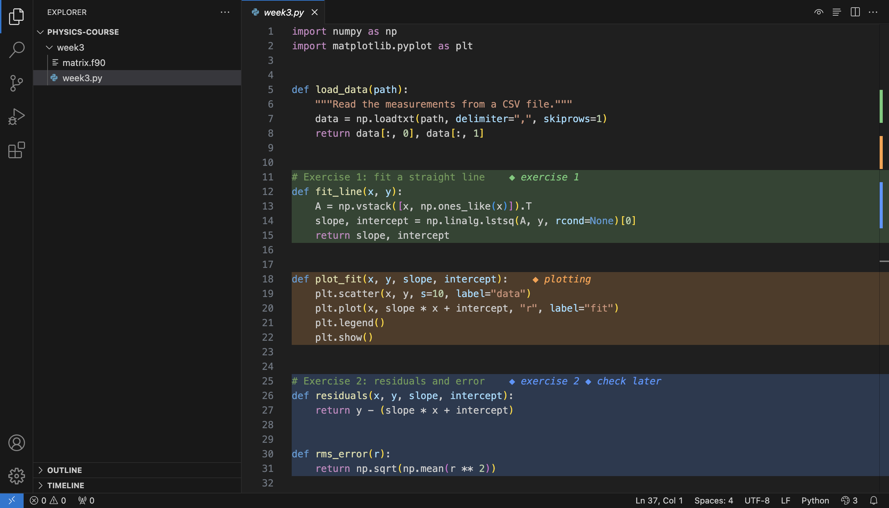
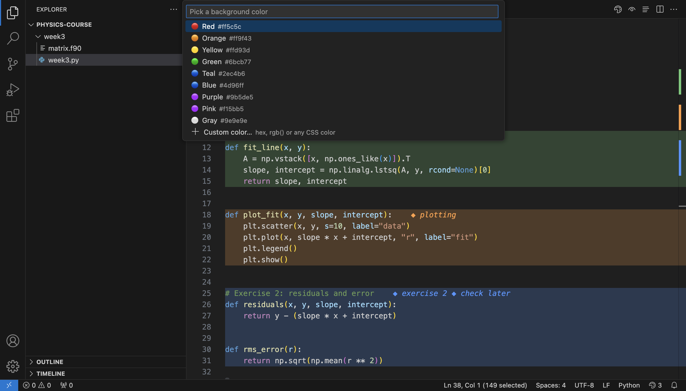
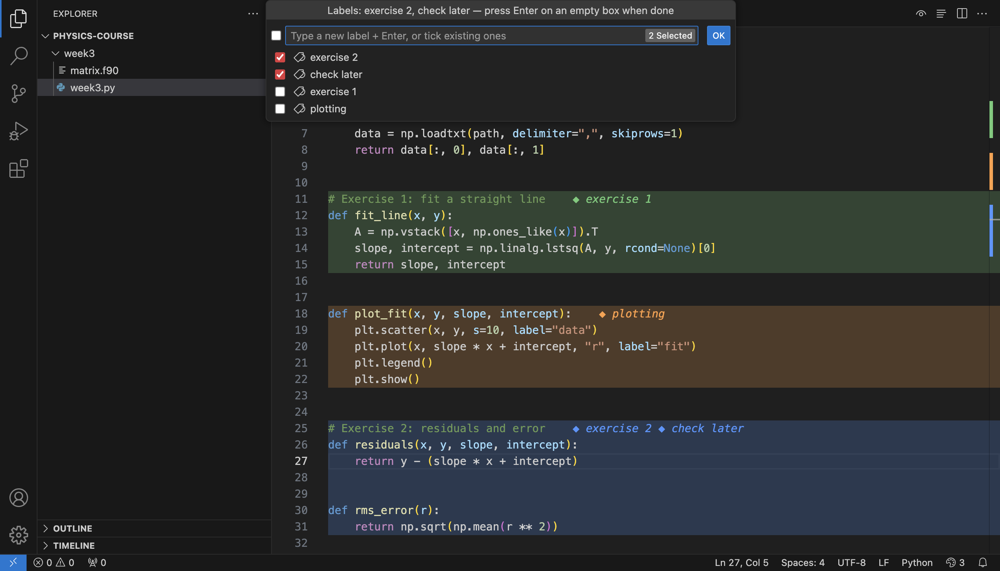
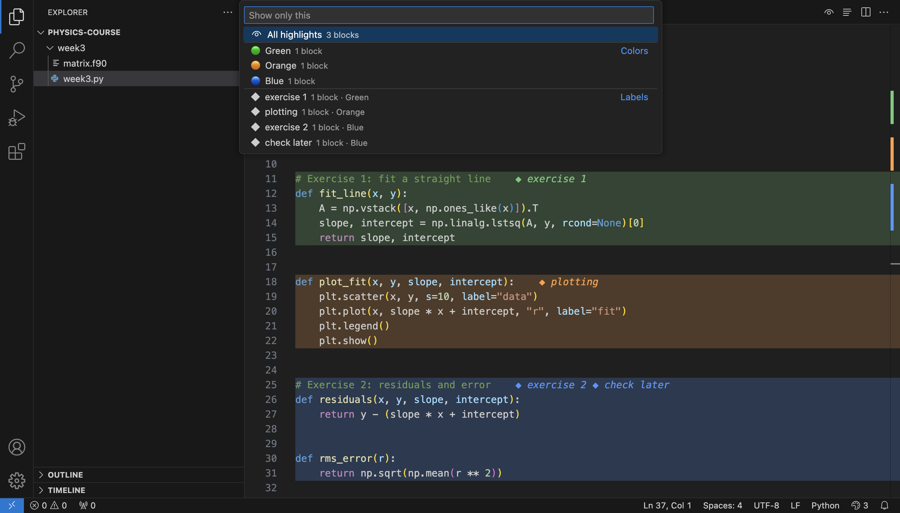
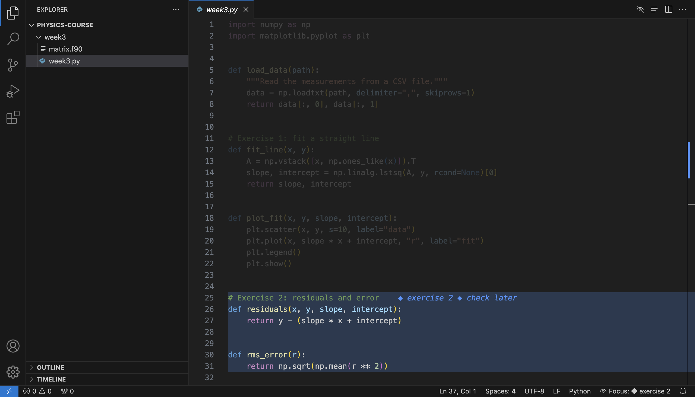
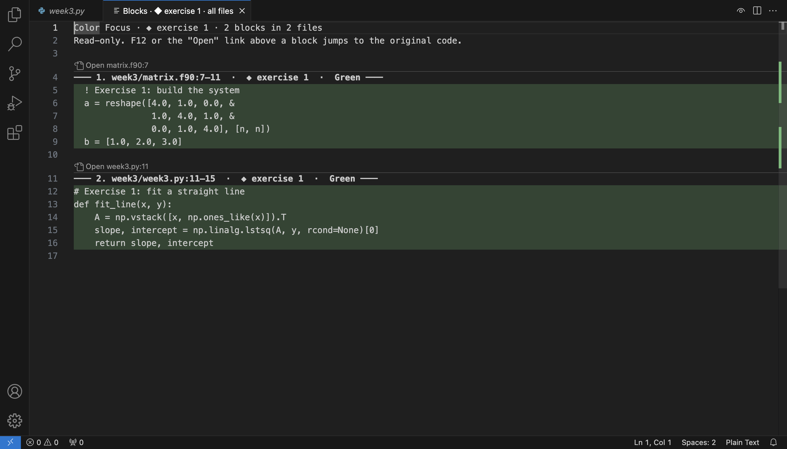

# Color Focus

**Paint blocks of code with a background color, label them, and focus on just the parts you care about.**

Select some code, pick a color, add a label like `exercise 1`. The color stays after you click away, follows the code as you edit, and is still there tomorrow. Then dim everything else, fold the block away, or pull every `exercise 1` block from every file into one stacked view.

**Works with AI coding agents.** Ask [Claude Code](https://claude.com/claude-code) or [Codex](https://openai.com/codex) to "solve exercise 1", and every block of code it writes is highlighted and labeled **Exercise 1** automatically. [Set it up in one step →](#let-claude-code-or-codex-highlight-the-code-they-write)

Works in every language VS Code can open: Python, JavaScript/TypeScript, Java, C/C++, Fortran, MATLAB, Julia, CSS, HTML, Markdown, plain text and more.



---

## Features

### Color any block of code

Select lines → **Option+Tab, then H** (Windows/Linux: **Ctrl+Alt+H**) → pick a color. Or right-click → **Highlight Selection With Color…**, or use the palette button at the top right of the editor.

- Highlights stay after you deselect and are saved between sessions.
- They move with the code when you type above or inside them, follow files you rename, and follow changes made outside VS Code (by Claude Code, Codex, git or another editor).
- Color as many blocks as you like, with several selections at once if you want.
- 9 built-in colors plus any custom CSS color. Colored marks in the scrollbar show where every block is.



### Labels, as many as you need

After picking a color you can give the block one or more labels, e.g. `exercise 2` and `check later`. Labels show at the end of the block's first line and when you hover over the block. Labels you used before are offered again, in every file.

Change them any time: cursor in the block → **Option+Tab, then L** (Windows/Linux: **Ctrl+Alt+L**).



### Focus mode

**Option+Tab, then F** (Windows/Linux: **Ctrl+Alt+F**) → pick a color, a label, or all highlights. Everything else fades out so you can read just that part. Press the same keys again, or `Esc`, to show everything.





### Show only the highlighted blocks, from one file or all of them

**Option+Tab, then B** (Windows/Linux: **Ctrl+Alt+B**) → choose **This file** or **All files in this workspace** → choose **All**, a **label** or a **color**.

The matching blocks open stacked one after another in a read-only tab. Each one has a header with the file, line numbers and labels. Click **Open file:line**, or press `F12` / `Enter` inside a block, to jump to the real code. The view updates live while you edit.



### Fold a block, even across functions

Cursor in a block → **Option+Tab, then C** (Windows/Linux: **Ctrl+Alt+C**) folds the whole block, even if it starts inside a function and ends after it. Press again to unfold. After the first fold the block keeps a fold arrow next to the line numbers.

### Jump between blocks

**Option+Tab, then ↓ / ↑** (Windows/Linux: **Ctrl+Alt+] / [**) jumps to the next or previous block. Keep pressing **↓ / ↑** to keep jumping; any other key stops. In focus mode, **Option+↓ / ↑** jumps directly.

### Let Claude Code or Codex highlight the code they write

If you use [Claude Code](https://claude.com/claude-code) or OpenAI's [Codex](https://openai.com/codex), Color Focus can highlight every block of code the agent writes or changes, labeled with the exercise it belongs to:

> **You:** solve exercise 3
>
> The agent writes the code, and in VS Code every new or changed block is colored and labeled **Exercise 3**.

You don't have to ask for highlighting or explain anything: just name the exercise, task or assignment as you normally would ("do opgave 2b", "solve part A", "implement task 4"). Ask for several at once ("solve exercise 1, 2 and 3") and each one gets its own label and color.

The agent's highlights always have a label. If it later changes code from an earlier exercise, that code keeps its old label and gets the new one too, so focusing on either exercise shows all of it. Everything above works with these labels: focus on "Exercise 3", stack all its blocks from every file, fold them, or rename the label.

**Set up once** (needs [Node.js](https://nodejs.org)):

| Agent | Steps |
| --- | --- |
| **Claude Code** | Command Palette → **Color Focus: Set Up Claude Code Integration…** → restart Claude Code. |
| **Codex** (app, CLI or IDE extension) | Command Palette → **Color Focus: Set Up Codex Integration…** → restart Codex. Codex only runs hooks you've approved: the first time, review and trust the Color Focus hook when Codex asks, or with `/hooks` in Codex. |

Use both if you like; they share the same labels. Run a setup command again to reinstall or remove it.

<details>
<summary>How it works and what it installs</summary>

- A **skill** tells the agent to turn a label on when you ask it to work on a named exercise, task or assignment, and off when it's done. Claude Code: `~/.claude/skills/color-focus`. Codex: `~/.agents/skills/color-focus`.
- A **hook** notes which lines each of the agent's file edits added or changed, while a label is on. Claude Code: in `~/.claude/settings.json`. Codex: in `~/.codex/hooks.json`. The file is backed up first, and your other hooks are kept.
- With Codex, the hook also turns labels on and off for the agent. Codex runs commands in a sandbox that can't write outside your project, and the hook runs outside it, so you aren't asked for permission every time a label changes.
- Small **scripts** in `~/.color-focus/bin`, shared by both agents. You can also use them yourself:
  - `~/.color-focus/bin/color-focus start "Exercise 1"`: highlight the agent's changes as "Exercise 1" from now on
  - `~/.color-focus/bin/color-focus stop`: stop
  - `~/.color-focus/bin/color-focus add file.py 10-25 --label "Exercise 1"`: highlight lines by hand
- The extension picks the highlights up from `~/.color-focus/inbox`, also for files that aren't open. If VS Code is closed, they're added the next time it opens.
- Only edits made with the agent's own file-editing tool are highlighted (Edit/Write in Claude Code, apply_patch in Codex), not files changed by shell commands or scripts it runs.
- Nothing is sent anywhere: everything stays in these folders on your computer.
</details>

### Clean up and rename in bulk

- **Remove a highlight:** cursor in a block → **Option+Tab, then X** (Windows/Linux: **Ctrl+Alt+X**). With lines selected, only those lines lose their color.
- **Remove Highlights…** in a file, a folder or everywhere: all of them, or only those with a certain label or color. You can also remove just a label and keep the color.
- **Rename Label…** in a file, a folder or everywhere, e.g. `Exercise 1` → `Exercise 0`.

Right-click in the editor (this file) or on a file or folder in the Explorer. Both ask before changing anything and offer **Undo** afterwards.

---

## Getting started

1. Select a few lines of code.
2. Press **Option+Tab, then H** (Windows/Linux: **Ctrl+Alt+H**), or right-click → **Highlight Selection With Color…**
3. Pick a color, type a label (or just press `Enter`), done.

## Keyboard shortcuts

On **Mac**, press **Option+Tab**, then one key. You can let go of Option before the key or keep holding it.
On **Windows/Linux**, hold **Ctrl+Alt** and press the key.

| Key | Does |
| --- | --- |
| `H` | Highlight the selection |
| `X` | Remove highlight (the whole block, or only the selected lines) |
| `L` | Add/remove labels on the block at the cursor |
| `F` | Focus mode on/off (`Esc` also turns it off) |
| `B` | Show highlighted blocks only |
| `C` | Fold/unfold the block at the cursor |
| `↓` / `↑` | Next/previous block, then keep pressing `↓` / `↑` (Windows/Linux: `]` / `[`) |

None of these clash with VS Code's built-in shortcuts. Change them in **Keyboard Shortcuts** (`Cmd+K Cmd+S` / `Ctrl+K Ctrl+S`) by searching "Color Focus".

### Your own shortcuts for specific colors and labels

Commands accept arguments, so you can make one-key shortcuts in `keybindings.json`:

```json
[
  { "key": "cmd+alt+1", "command": "colorFocus.highlight", "args": { "color": "#6bcb77", "labels": ["exercise 1"] } },
  { "key": "cmd+alt+shift+1", "command": "colorFocus.showBlocks", "args": { "scope": "workspace", "label": "exercise 1" } },
  { "key": "cmd+alt+0", "command": "colorFocus.renameLabel", "args": { "folder": "", "from": "Exercise 1", "to": "Exercise 0" } }
]
```

| Command | Arguments |
| --- | --- |
| `colorFocus.highlight` | `color`, and `labels` (a list) or `label` |
| `colorFocus.showBlocks` | `scope`: `"file"` or `"workspace"`; optionally `label` or `color` |
| `colorFocus.removeInFolder` | `folder` (path; `""` = everywhere) or `file`; `all: true`, `label` or `color`; `labelOnly`; `confirm: false` to skip the question |
| `colorFocus.renameLabel` | `folder` or `file`, `from`, `to` |

## All commands

Open the Command Palette (`Cmd+Shift+P` / `Ctrl+Shift+P`) and type "Color Focus":

| Command | What it does |
| --- | --- |
| Highlight Selection With Color… | Color the selected lines |
| Add/Remove Labels… | Edit the labels of the block at the cursor |
| Remove Highlight at Cursor | Remove a block, or only the selected lines |
| Focus on Color or Label… / Exit Focus Mode | Fade out everything else |
| Show Highlighted Blocks Only… | Stacked view of blocks from this file or all files |
| Fold/Unfold Highlighted Block | Fold the block at the cursor |
| Fold / Unfold All Highlighted Blocks | Fold every block in the file |
| Go to Next / Previous Highlight | Jump between blocks |
| List Highlights in This File… | Searchable list of blocks by label, color or code |
| Remove Highlights… | Remove in a file, folder or everywhere, by label or color |
| Rename Label… | Rename a label in a file, folder or everywhere |
| Clear All Highlights in This File | Start over in this file |
| Set Up Claude Code Integration… | Let Claude Code highlight the code it writes (see above) |
| Set Up Codex Integration… | Let Codex highlight the code it writes (see above) |

## Settings

| Setting | Default | What it does |
| --- | --- | --- |
| `colorFocus.colors` | 9 colors | The color list. Add your own, e.g. `{ "name": "Bugs", "color": "#ff0000" }` |
| `colorFocus.backgroundOpacity` | `0.22` | Strength of the background color |
| `colorFocus.wholeLine` | `true` | Color whole lines edge to edge. `false` colors only the selected characters |
| `colorFocus.askForLabel` | `true` | Ask for labels after picking a color |
| `colorFocus.showLabels` | `true` | Show labels at the end of the block's first line |
| `colorFocus.dimOpacity` | `0.2` | How faded other code is in focus mode (0 = invisible) |
| `colorFocus.foldable` | `true` | Allow folding highlighted blocks |
| `colorFocus.showInOverviewRuler` | `true` | Colored marks in the scrollbar |

## Good to know

- **Your files are never changed.** Highlights and labels are stored by VS Code on your computer, not in your code, and nothing is sent anywhere.
- Highlights are stored per computer. With two VS Code windows open at once, add highlights in one window at a time.
- When a file is changed outside VS Code, highlights are moved by comparing the old and new text line by line. If the code inside a block was rewritten completely, the block covers whatever replaced it.
- If you delete a highlighted block and then undo, the color doesn't come back.
- The stacked blocks view is read-only. When blocks from different languages are stacked, it has no syntax colors.
- If a block starts on the same line as a function, that line's fold arrow folds the block instead of the function.
- On Mac, an app switcher that uses Option+Tab (such as AltTab) takes over these shortcuts. Change them in Keyboard Shortcuts.

## License

[MIT](LICENSE)
